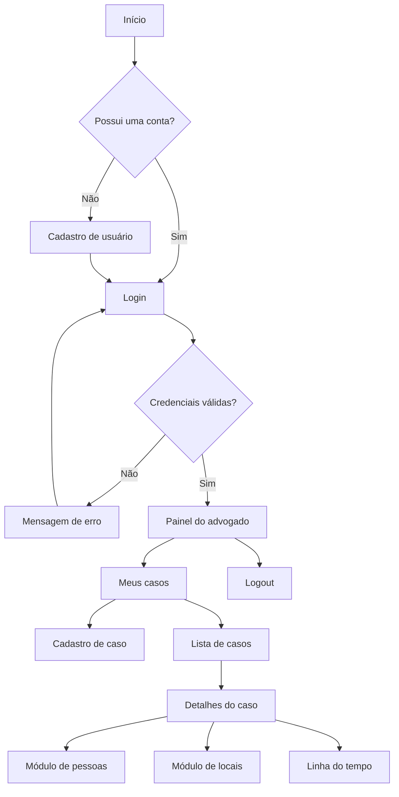

<div align="center">

# VERITAS

### Organização de informações para a defesa criminal

Protótipo acadêmico de aplicação web para cadastro, organização e consulta de casos simulados.


</div>

---

## Sobre o projeto

O **Projeto VERITAS** é um protótipo acadêmico de aplicação web desenvolvido para auxiliar a organização de informações relacionadas a casos simulados de defesa criminal.

A proposta é oferecer ao advogado um ambiente centralizado para registrar casos e, progressivamente, organizar pessoas, locais, acontecimentos, evidências e informações cronológicas. O sistema foi pensado como uma ferramenta de apoio à organização da informação, sem substituir a análise jurídica realizada pelo profissional.

> **Aviso:** o VERITAS utiliza dados fictícios ou simulados. Não insira informações reais de clientes, acusados, vítimas, testemunhas, processos ou documentos jurídicos.

## Objetivo acadêmico

Desenvolver e avaliar um protótipo web capaz de demonstrar recursos de:

- autenticação de usuários;

- controle de sessão;

- controle de acesso;

- persistência de dados;

- organização de casos;

- modelagem de informações jurídicas simuladas;

- desenvolvimento de uma interface orientada à organização visual dos dados.

## Estado atual do desenvolvimento

### Funcionalidades já desenvolvidas

- [x] Estrutura inicial do projeto PHP;

- [x] Identidade visual inspirada em um dossiê jurídico;

- [x] Conexão com o banco de dados MySQL utilizando PDO;

- [x] Cadastro de usuário;

- [x] Validação de nome, e-mail e senha;

- [x] Verificação de e-mail duplicado;

- [x] Proteção de senha com `password_hash()`;

- [x] Login com `password_verify()`;

- [x] Criação e manutenção de sessão;

- [x] Logout;

- [x] Proteção das páginas internas;

- [x] Painel inicial do advogado;

- [x] Cadastro de casos;

- [x] Listagem dos casos do usuário autenticado;

- [x] Status de caso: aberto, em revisão e arquivado;

- [x] Página de detalhes de um caso;

- [x] Verificação de propriedade do caso pelo usuário logado;

- [x] Estrutura inicial do módulo de pessoas participantes.

### Próximas funcionalidades

- [ ] Finalizar e testar o cadastro de pessoas;

- [ ] Cadastro de locais;

- [ ] Cadastro de acontecimentos;

- [ ] Construção da linha do tempo;

- [ ] Cadastro de evidências;

- [ ] Upload controlado de arquivos;

- [ ] Alertas de possíveis conflitos para revisão profissional;

- [ ] Pesquisa e filtros;

- [ ] Auditoria das ações realizadas;

- [ ] Testes funcionais completos;

- [ ] Avaliação do protótipo.

## Fluxo atual do sistema



## Tecnologias utilizadas

| Tecnologia | Utilização |
| --- | --- |
| **PHP** | Lógica da aplicação e processamento dos formulários |
| **MySQL** | Armazenamento dos dados do sistema |
| **PDO** | Conexão segura entre PHP e MySQL |
| **HTML5** | Estrutura das páginas |
| **CSS3** | Identidade visual e responsividade |
| **XAMPP** | Execução local do Apache, PHP e MySQL |
| **MySQL Workbench** | Criação e administração do banco de dados |
| **Visual Studio Code** | Desenvolvimento do código |
| **GitHub** | Versionamento e armazenamento do projeto |

## Identidade visual

A interface utiliza uma linguagem visual inspirada em documentos e dossiês jurídicos, com:

- tons de vinho e azul-petróleo;

- fundos claros semelhantes a papel;

- tipografia com aparência editorial;

- cartões de informação;

- etiquetas técnicas;

- organização por módulos;

- destaque para status e identificação dos casos.

A identidade foi criada para manter uma aparência acadêmica, profissional e coerente com o contexto da defesa criminal.

## Estrutura do projeto

```
veritas/
├── assets/
│   └── css/
│       └── style.css
├── config/
│   └── conexao.php
├── views/
│   ├── cadastro.php
│   ├── caso.php
│   ├── casos.php
│   ├── home.php
│   ├── layout.php
│   ├── login.php
│   ├── painel.php
│   ├── pessoas.php
│   └── ...
├── .gitignore
├── index.php
└── README.md
```

## Como executar localmente

### Requisitos

- XAMPP instalado;

- Apache ativo;

- MySQL ativo;

- MySQL Workbench instalado;

- PHP habilitado no XAMPP;

- navegador web.

### 1. Colocar o projeto no XAMPP

Copie ou clone o projeto para:

```
C:\xampp\htdocs\veritas
```

### 2. Iniciar o ambiente

Abra o XAMPP e inicie:

- **Apache**;

- **MySQL**.

### 3. Criar o banco de dados

No MySQL Workbench, execute o script SQL do projeto para criar o banco `veritas` e suas tabelas.

O banco utilizado pela aplicação é:

```
veritas
```

### 4. Conferir a conexão

Verifique o arquivo:

```
config/conexao.php
```

Ajuste os dados conforme a instalação local do MySQL:

```php
$host = '127.0.0.1';
$porta = '3306';
$banco = 'veritas';
$usuario = 'root';
$senha = '';
```

> Nunca publique senhas reais no GitHub. Se o MySQL utilizar uma senha, mantenha a configuração sensível apenas no ambiente local.

### 5. Acessar o sistema

Abra no navegador:

```
http://localhost/veritas/
```

## Principais rotas atuais

| Rota | Função |
| --- | --- |
| `index.php` | Entrada principal e roteamento das páginas |
| `index.php?pagina=cadastro` | Cadastro de usuário |
| `index.php?pagina=login` | Login do usuário |
| `index.php?pagina=painel` | Painel protegido |
| `index.php?pagina=casos` | Cadastro e listagem de casos |
| `index.php?pagina=caso&id=1` | Detalhes de um caso |
| `index.php?pagina=pessoas&caso_id=1` | Pessoas relacionadas ao caso |
| `index.php?pagina=sair` | Encerramento da sessão |

## Segurança aplicada no protótipo

O projeto utiliza algumas práticas básicas de segurança:

- consultas preparadas com PDO;

- validação dos dados recebidos por `POST`;

- proteção das senhas com `password_hash( )`;

- conferência com `password_verify()`;

- controle de acesso por sessão;

- regeneração do identificador da sessão após o login;

- uso de `htmlspecialchars()` na exibição de dados;

- filtragem do ID recebido pela URL;

- verificação de que o caso pertence ao usuário autenticado.

Esses recursos fazem parte do protótipo acadêmico e não representam uma certificação de segurança para uso em produção.

## Limitações do projeto

O VERITAS:

- não substitui a análise de um advogado;

- não realiza consulta a tribunais ou órgãos oficiais;

- não determina culpa ou inocência;

- não valida a autenticidade de documentos;

- não realiza perícia digital;

- não implementa cadeia de custódia jurídica;

- não deve receber dados reais durante os testes acadêmicos;

- ainda está em fase de desenvolvimento.

## Versionamento

As alterações devem ser registradas com commits descritivos. Exemplos:

```
feat: adiciona cadastro de pessoas
fix: corrige validação do login
style: ajusta identidade visual dos casos
docs: atualiza README do projeto
```

## Projeto acadêmico

Este repositório integra o desenvolvimento do Trabalho de Conclusão de Curso.

**Autor:** Cauan Oliveira
**Curso:** Informática com Ênfase em Programação
**Instituição:** Fucapi
**Orientador:** Walter Walker
**Ano:** 2026

<div align="center">

Desenvolvido para fins acadêmicos.

</div>

---

# Atualização do desenvolvimento — 07/11/2026

Esta seção foi acrescentada para registrar, de forma explicativa, as mudanças realizadas no sistema até o momento. O conteúdo anterior do README foi mantido sem alterações.

## Funcionalidades implementadas recentemente

### Página inicial pública

Foi criada a página inicial do Projeto VERITAS, apresentada quando o usuário acessa o endereço principal da aplicação. A página contém a apresentação do sistema, a identidade visual inspirada em um dossiê jurídico, os botões de cadastro e login e um aviso sobre a finalidade acadêmica do protótipo.

### Cadastro e autenticação

O sistema passou a possuir um fluxo completo de entrada do usuário, composto por cadastro, login, sessão e logout. O cadastro valida os campos, impede e-mails duplicados e armazena as senhas utilizando `password_hash()`. No login, a senha é conferida com `password_verify()`.

Também foi implementado o controle de acesso às páginas internas. Dessa forma, páginas como painel, casos, detalhes do caso, pessoas, locais e acontecimentos exigem que o usuário esteja autenticado.

### Painel do advogado

Após o login, o usuário é encaminhado ao painel principal. O painel identifica o advogado logado e apresenta os módulos disponíveis no protótipo, incluindo o acesso aos casos cadastrados.

### Cadastro e organização de casos

Foi implementado o cadastro de casos com título, descrição e status. Os status disponíveis são:

- aberto;

- em revisão;

- arquivado.

A listagem mostra somente os casos pertencentes ao usuário autenticado. Também foi criada a página de detalhes de cada caso, com validação do proprietário do registro.

### Módulo de pessoas

Foi implementado o módulo de pessoas relacionadas a um caso. O usuário pode cadastrar nome, papel no caso e observações.

Os papéis disponíveis incluem:

- acusado;

- vítima;

- testemunha;

- perito;

- investigador;

- outra pessoa.

Os registros ficam vinculados ao caso aberto e podem ser consultados na página específica do módulo.

### Módulo de locais

Foi implementado o cadastro de locais relacionados aos casos. Cada local possui nome, endereço e observações.

A modelagem utilizada atualmente é:

```
casos 1 ─── N locais
```

Isso significa que um caso pode possuir vários locais e cada local pertence diretamente a um caso por meio da coluna `caso_id`.

Durante o desenvolvimento, foi identificada e corrigida uma inconsistência entre a tabela existente e o código PHP. A implementação final passou a utilizar diretamente `locais.caso_id`, mantendo o código e o banco coerentes.

### Módulo de acontecimentos

Foi criado o módulo de acontecimentos, que permite registrar fatos relacionados a um caso. Cada registro pode conter:

- título;

- descrição;

- data do evento;

- horário do evento;

- local relacionado.

Os acontecimentos são exibidos em ordem cronológica utilizando `data_evento` e `hora_evento`. Esse módulo constitui a base funcional da futura linha do tempo do sistema.

### Interface dos acontecimentos

Foi acrescentada uma apresentação visual em formato de linha cronológica. A interface diferencia a área de cadastro da área de registros e apresenta data, horário, título, descrição e local relacionado.

Os aprimoramentos visuais mais detalhados, como ícones, filtros, edição e exclusão, serão realizados posteriormente, após a conclusão das funcionalidades principais.

## Estrutura atual do banco relacionada aos módulos

Até o momento, as principais relações implementadas são:

```
usuarios 1 ─── N casos
casos 1 ─── N pessoas relacionadas
casos 1 ─── N locais
casos 1 ─── N acontecimentos
acontecimentos N ─── 1 local opcional
```

A estrutura final do MER e do DER será revisada depois da conclusão dos módulos, para garantir que os diagramas representem exatamente o banco utilizado pelo sistema.

## Percentual estimado de conclusão

O percentual abaixo é uma estimativa acadêmica do desenvolvimento geral, considerando funcionalidades, banco de dados, testes, documentação e diagramas:

```
Projeto completo: aproximadamente 45%
```

A estimativa considera que a base estrutural e os principais fluxos de autenticação já estão funcionando, mas ainda faltam módulos importantes e a etapa final de documentação e testes.

### Situação por área

| Área | Situação estimada |
| --- | --- |
| Estrutura inicial e ambiente | 100% |
| Identidade visual inicial | 80% |
| Cadastro, login e sessões | 100% |
| Casos e detalhes do caso | 100% |
| Pessoas relacionadas | 100% |
| Locais relacionados | 100% |
| Acontecimentos | 90% |
| Linha do tempo completa | 25% |
| Evidências | 0% |
| Upload de arquivos | 0% |
| Alertas | 0% |
| Pesquisa e filtros | 0% |
| Auditoria | 0% |
| Testes funcionais finais | 25% |
| MER e DER finais | 40% |
| Documentação final do TCC | 60% |

Esses percentuais são aproximados e servem apenas para acompanhar o andamento do projeto. Eles não representam uma medição oficial de produtividade.

## Próximo passo planejado

O próximo módulo será o cadastro e a listagem de evidências. A tabela `evidencias` já foi verificada no banco e possui os seguintes campos principais:

```
id
caso_id
categoria_id
local_id
titulo
descricao
data_registro
hora_registro
criado_em
atualizado_em
```

A implementação começará pelo cadastro e pela listagem das evidências. O upload de arquivos será desenvolvido posteriormente, com validação de extensão e tamanho.

Após a conclusão das principais funcionalidades, será realizada uma revisão geral para:

1. conferir as tabelas realmente utilizadas;

1. remover estruturas redundantes;

1. revisar as chaves estrangeiras;

1. atualizar o MER;

1. atualizar o DER;

1. realizar os testes funcionais;

1. registrar os resultados no TCC.
