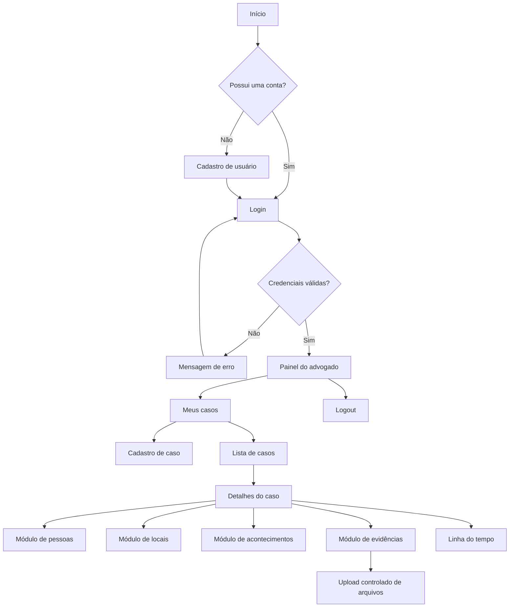

<div align="center">

# VERITAS

### Organização de informações para a defesa criminal

Protótipo acadêmico de aplicação web para cadastro, organização e consulta de casos simulados.


</div>

---

## Sobre o projeto

O **Projeto VERITAS** é um protótipo acadêmico de aplicação web desenvolvido para auxiliar a organização de informações relacionadas a casos simulados de defesa criminal.

A proposta é oferecer ao advogado um ambiente centralizado para registrar casos e organizar pessoas, locais, acontecimentos, evidências e informações cronológicas. O sistema foi pensado como uma ferramenta de apoio à organização da informação, sem substituir a análise jurídica realizada pelo profissional.

> **Aviso:** o VERITAS utiliza dados fictícios ou simulados. Não insira informações reais de clientes, acusados, vítimas, testemunhas, processos ou documentos jurídicos.

## Objetivo acadêmico

Desenvolver e avaliar um protótipo web capaz de demonstrar recursos de:

- autenticação de usuários;

- controle de sessão;

- controle de acesso;

- persistência de dados;

- organização de casos;

- modelagem de informações jurídicas simuladas;

- cadastro de pessoas, locais, acontecimentos e evidências;

- armazenamento controlado de arquivos;

- organização visual e cronológica dos dados.

## Estado atual do desenvolvimento

### Funcionalidades desenvolvidas

- [x] Estrutura inicial do projeto PHP;

- [x] Identidade visual inspirada em um dossiê jurídico;

- [x] Conexão com o banco de dados MySQL utilizando PDO;

- [x] Cadastro de usuário;

- [x] Validação de nome, e-mail e senha;

- [x] Verificação de e-mail duplicado;

- [x] Proteção de senha com `password_hash()`;

- [x] Login com `password_verify()`;

- [x] Criação e manutenção de sessão;

- [x] Logout;

- [x] Proteção das páginas internas;

- [x] Painel inicial do advogado;

- [x] Cadastro de casos;

- [x] Listagem dos casos do usuário autenticado;

- [x] Status de caso: aberto, em revisão e arquivado;

- [x] Página de detalhes de um caso;

- [x] Verificação de propriedade do caso pelo usuário logado;

- [x] Cadastro e listagem de pessoas relacionadas aos casos;

- [x] Cadastro e listagem de locais relacionados aos casos;

- [x] Cadastro e listagem de acontecimentos;

- [x] Organização cronológica dos acontecimentos;

- [x] Cadastro e listagem de evidências;

- [x] Criação da tabela `arquivos_evidencia`;

- [x] Configuração de pasta externa para armazenamento de arquivos;

- [x] Validação inicial de arquivos PDF, JPG e PNG;

- [x] Geração de nomes internos aleatórios para arquivos;

- [x] Registro de metadados e hash SHA-256 dos arquivos.

### Próximas funcionalidades

- [ ] Finalizar os testes dos módulos de pessoas, locais e acontecimentos;

- [ ] Concluir os testes do upload de arquivos no XAMPP;

- [ ] Criar visualização ou download protegido dos arquivos;

- [ ] Construir a linha do tempo integrada;

- [ ] Implementar alertas explicáveis de possíveis conflitos;

- [ ] Implementar pesquisa e filtros;

- [ ] Implementar auditoria das ações realizadas;

- [ ] Executar os testes funcionais completos;

- [ ] Avaliar o protótipo;

- [ ] Atualizar definitivamente o MER e o DER;

- [ ] Finalizar a documentação do TCC.

## Fluxo atual do sistema



## Tecnologias utilizadas

| Tecnologia | Utilização |
| --- | --- |
| **PHP 8+** | Lógica da aplicação e processamento dos formulários |
| **MySQL** | Armazenamento dos dados do sistema |
| **PDO** | Conexão segura entre PHP e MySQL |
| **HTML5** | Estrutura das páginas |
| **CSS3** | Identidade visual e responsividade |
| **XAMPP** | Execução local do Apache, PHP e MySQL |
| **MySQL Workbench** | Criação e administração do banco de dados |
| **Visual Studio Code** | Desenvolvimento do código |
| **GitHub** | Versionamento e armazenamento do projeto |

## Identidade visual

A interface utiliza uma linguagem visual inspirada em documentos e dossiês jurídicos, com:

- tons de vinho e azul-petróleo;

- fundos claros semelhantes a papel;

- tipografia com aparência editorial;

- cartões de informação;

- etiquetas técnicas;

- organização por módulos;

- destaque para status e identificação dos casos.

A identidade foi criada para manter uma aparência acadêmica, profissional e coerente com o contexto da defesa criminal.

## Estrutura do projeto

```
veritas/
├── assets/
│   └── css/
│       └── style.css
├── config/
│   ├── conexao.php
│   ├── configuracoes_locais.example.php
│   └── configuracoes_locais.php
├── views/
│   ├── cadastro.php
│   ├── caso.php
│   ├── casos.php
│   ├── acontecimentos.php
│   ├── evidencias.php
│   ├── home.php
│   ├── layout.php
│   ├── locais.php
│   ├── login.php
│   ├── painel.php
│   ├── pessoas.php
│   └── ...
├── .gitignore
├── index.php
└── README.md
```

> O arquivo `configuracoes_locais.php` é utilizado somente no ambiente local e não deve ser enviado ao GitHub. Apenas `configuracoes_locais.example.php` deve ser versionado.

## Como executar localmente

### Requisitos

- XAMPP instalado;

- Apache ativo;

- MySQL ativo;

- MySQL Workbench instalado;

- PHP habilitado no XAMPP;

- navegador web.

### 1. Colocar o projeto no XAMPP

Copie ou clone o projeto para:

```
C:\xampp\htdocs\veritas
```

### 2. Iniciar o ambiente

Abra o XAMPP e inicie:

- **Apache**;

- **MySQL**.

### 3. Criar o banco de dados

No MySQL Workbench, execute o script SQL do projeto para criar o banco `veritas` e suas tabelas.

O banco utilizado pela aplicação é:

```
veritas
```

### 4. Conferir a conexão

Verifique o arquivo:

```
config/conexao.php
```

Ajuste os dados conforme a instalação local do MySQL:

```php
$host = '127.0.0.1';
$porta = '3306';
$banco = 'veritas';
$usuario = 'root';
$senha = '';
```

> Nunca publique senhas reais no GitHub. Se o MySQL utilizar uma senha, mantenha a configuração sensível apenas no ambiente local.

### 5. Configurar o armazenamento de arquivos

Crie, fora da pasta pública do Apache, a pasta:

```
C:\xampp\veritas_storage\evidencias
```

O arquivo local de configuração deve conter o caminho da pasta:

```php
define(
    'PASTA_ARMAZENAMENTO_EVIDENCIAS',
    'C:/xampp/veritas_storage/evidencias/'
);
```

O arquivo `config/configuracoes_locais.php` não deve ser enviado ao GitHub. Utilize `configuracoes_locais.example.php` como modelo.

### 6. Acessar o sistema

Abra no navegador:

```
http://localhost/veritas/
```

## Principais rotas atuais

| Rota | Função |
| --- | --- |
| `index.php` | Entrada principal e roteamento das páginas |
| `index.php?pagina=cadastro` | Cadastro de usuário |
| `index.php?pagina=login` | Login do usuário |
| `index.php?pagina=painel` | Painel protegido |
| `index.php?pagina=casos` | Cadastro e listagem de casos |
| `index.php?pagina=caso&id=1` | Detalhes de um caso |
| `index.php?pagina=pessoas&caso_id=1` | Pessoas relacionadas ao caso |
| `index.php?pagina=locais&caso_id=1` | Locais relacionados ao caso |
| `index.php?pagina=acontecimentos&caso_id=1` | Acontecimentos do caso |
| `index.php?pagina=evidencias&caso_id=1` | Evidências do caso |
| `index.php?pagina=sair` | Encerramento da sessão |

## Armazenamento de arquivos de evidências

O módulo de evidências foi preparado para aceitar arquivos relacionados aos registros cadastrados.

Nesta primeira versão, o conteúdo dos arquivos não é salvo diretamente no MySQL. O banco de dados armazena somente os metadados, como:

- nome original do arquivo;

- nome interno gerado pelo sistema;

- caminho relativo;

- tipo MIME;

- tamanho em bytes;

- hash SHA-256;

- data de cadastro;

- identificação da evidência relacionada.

Os arquivos são armazenados em uma pasta externa ao diretório público do Apache:

```
C:\xampp\veritas_storage\evidencias
```

Essa separação evita que os documentos sejam acessados diretamente por uma URL pública simples.

Os formatos inicialmente permitidos são:

```
PDF, JPG e PNG
```

O limite definido para o protótipo é de 5 MB por arquivo. O sistema também verifica o tipo MIME real, gera um nome interno aleatório e não utiliza diretamente o nome enviado pelo usuário.

A tabela utilizada para os metadados é:

```
arquivos_evidencia
```

Sua relação principal é:

```
evidencias 1 ─── N arquivos_evidencia
```

Isso significa que uma evidência pode possuir um ou mais arquivos associados.

> O upload ainda deve ser testado completamente no ambiente XAMPP antes de ser considerado finalizado para o protótipo.

## Segurança aplicada no protótipo

O projeto utiliza algumas práticas básicas de segurança:

- consultas preparadas com PDO;

- validação dos dados recebidos por `POST`;

- proteção das senhas com `password_hash()`;

- conferência com `password_verify()`;

- controle de acesso por sessão;

- regeneração do identificador da sessão após o login;

- uso de `htmlspecialchars()` na exibição de dados;

- filtragem do ID recebido pela URL;

- verificação de que o caso pertence ao usuário autenticado;

- validação do tipo MIME dos arquivos enviados;

- limite de tamanho para uploads;

- geração de nomes aleatórios para arquivos;

- armazenamento dos arquivos fora de `htdocs`;

- cálculo de hash SHA-256 para identificação do arquivo;

- uso de transação no cadastro da evidência e de seus metadados.

Esses recursos fazem parte do protótipo acadêmico e não representam uma certificação de segurança para uso em produção.

## Limitações do projeto

O VERITAS:

- não substitui a análise de um advogado;

- não realiza consulta a tribunais ou órgãos oficiais;

- não determina culpa ou inocência;

- não valida a autenticidade de documentos;

- não realiza perícia digital;

- não implementa cadeia de custódia jurídica completa;

- não deve receber dados reais durante os testes acadêmicos;

- ainda está em fase de desenvolvimento.

## Percentual estimado de conclusão

O percentual abaixo é uma estimativa acadêmica do desenvolvimento geral, considerando funcionalidades, banco de dados, testes, documentação e diagramas:

```
Projeto completo: aproximadamente 50%
```

### Situação por área

| Área | Situação estimada |
| --- | --- |
| Estrutura inicial e ambiente | 100% |
| Identidade visual inicial | 80% |
| Cadastro, login e sessões | 100% |
| Casos e detalhes do caso | 100% |
| Pessoas relacionadas | 100% |
| Locais relacionados | 100% |
| Acontecimentos | 90% |
| Evidências | 80% |
| Upload de arquivos | 35% |
| Linha do tempo completa | 25% |
| Alertas | 0% |
| Pesquisa e filtros | 0% |
| Auditoria | 0% |
| Testes funcionais finais | 25% |
| MER e DER finais | 40% |
| Documentação final do TCC | 60% |

Esses percentuais são aproximados e servem apenas para acompanhar o andamento do projeto. Eles não representam uma medição oficial de produtividade.

## Versionamento

As alterações devem ser registradas com commits descritivos. Exemplos:

```
feat: adiciona cadastro de pessoas
feat: implementa upload de evidências
fix: corrige validação do login
style: ajusta identidade visual das evidências
docs: atualiza README do projeto
```

## Próximas etapas

Após a implementação inicial das evidências, as próximas etapas são:

1. testar o upload no ambiente local;

1. criar a consulta protegida dos arquivos;

1. concluir a linha do tempo integrada;

1. implementar alertas explicáveis de possíveis inconsistências;

1. executar os testes funcionais;

1. atualizar os diagramas MER e DER;

1. registrar os resultados no TCC.

---

# Histórico do desenvolvimento

## Atualização — 18/11/2026

### Módulo de evidências

Foi implementado o módulo de evidências, permitindo o cadastro de informações relacionadas aos casos, como título, descrição, categoria, local, data e horário.

As evidências são vinculadas diretamente ao caso correspondente e podem ser consultadas na página específica do módulo.

### Armazenamento de arquivos

Foi criada a tabela `arquivos_evidencia`, responsável por armazenar os metadados dos arquivos associados às evidências.

Também foi configurada uma pasta externa ao diretório público do Apache para armazenar os arquivos físicos:

```
C:\xampp\veritas_storage\evidencias
```

A estrutura foi planejada para aceitar arquivos PDF, JPG e PNG, com limite de 5 MB, verificação do tipo MIME, geração de nome interno aleatório e cálculo de hash SHA-256.

O upload ainda deverá ser testado de forma completa no ambiente XAMPP antes de ser considerado finalizado.

### Relação entre evidências e arquivos

A relação implementada é:

```
evidencias 1 ─── N arquivos_evidencia
```

Uma evidência pode possuir um ou mais arquivos associados. O conteúdo do arquivo não é salvo diretamente no banco de dados, sendo armazenados no MySQL apenas seus metadados.

## Atualização — 07/11/2026

Durante o desenvolvimento anterior, foram implementados e ajustados os módulos de autenticação, casos, pessoas, locais e acontecimentos.

A aplicação passou a possuir página inicial pública, cadastro, login, controle de sessão, logout e proteção das páginas internas. Também foram criados os módulos de organização de casos e de informações relacionadas ao caso.

Os acontecimentos passaram a ser apresentados em ordem cronológica, constituindo a base funcional da futura linha do tempo integrada.

Durante a implementação dos locais, foi identificada e corrigida uma inconsistência entre a tabela existente e o código PHP. A implementação final passou a utilizar diretamente `locais.caso_id`, mantendo o código e o banco coerentes.

## Relações principais do banco

Até o momento, as principais relações implementadas são:

```
usuarios 1 ─── N casos
casos 1 ─── N pessoas relacionadas
casos 1 ─── N locais
casos 1 ─── N acontecimentos
casos 1 ─── N evidencias
evidencias 1 ─── N arquivos_evidencia
acontecimentos N ─── 1 local opcional
```

A estrutura final do MER e do DER será revisada depois da conclusão dos módulos, para garantir que os diagramas representem exatamente o banco utilizado pelo sistema.

## Projeto acadêmico

Este repositório integra o desenvolvimento do Trabalho de Conclusão de Curso.

**Autor:** Cauan Jesus
**Curso:** Informática com Ênfase em Programação
**Instituição:** Fucapi
**Orientador:** Walter Walker
**Ano:** 2026

<div align="center">

Desenvolvido para fins acadêmicos.

</div>
