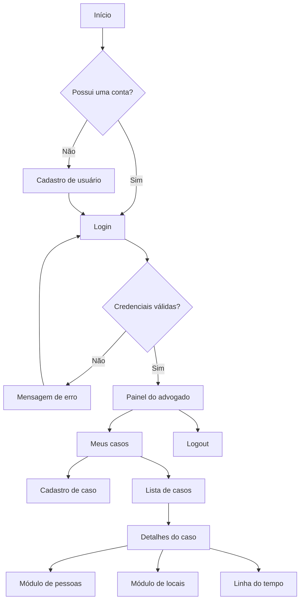

<div align="center">

# VERITAS

### Organização de informações para a defesa criminal

Protótipo acadêmico de aplicação web para cadastro, organização e consulta de casos simulados.


</div>

---

## Sobre o projeto

O **Projeto VERITAS** é um protótipo acadêmico de aplicação web desenvolvido para auxiliar a organização de informações relacionadas a casos simulados de defesa criminal.

A proposta é oferecer ao advogado um ambiente centralizado para registrar casos e, progressivamente, organizar pessoas, locais, acontecimentos, evidências e informações cronológicas. O sistema foi pensado como uma ferramenta de apoio à organização da informação, sem substituir a análise jurídica realizada pelo profissional.

> **Aviso:** o VERITAS utiliza dados fictícios ou simulados. Não insira informações reais de clientes, acusados, vítimas, testemunhas, processos ou documentos jurídicos.

## Objetivo acadêmico

Desenvolver e avaliar um protótipo web capaz de demonstrar recursos de:

- autenticação de usuários;

- controle de sessão;

- controle de acesso;

- persistência de dados;

- organização de casos;

- modelagem de informações jurídicas simuladas;

- desenvolvimento de uma interface orientada à organização visual dos dados.

## Estado atual do desenvolvimento

### Funcionalidades já desenvolvidas

- [x] Estrutura inicial do projeto PHP;

- [x] Identidade visual inspirada em um dossiê jurídico;

- [x] Conexão com o banco de dados MySQL utilizando PDO;

- [x] Cadastro de usuário;

- [x] Validação de nome, e-mail e senha;

- [x] Verificação de e-mail duplicado;

- [x] Proteção de senha com `password_hash()`;

- [x] Login com `password_verify()`;

- [x] Criação e manutenção de sessão;

- [x] Logout;

- [x] Proteção das páginas internas;

- [x] Painel inicial do advogado;

- [x] Cadastro de casos;

- [x] Listagem dos casos do usuário autenticado;

- [x] Status de caso: aberto, em revisão e arquivado;

- [x] Página de detalhes de um caso;

- [x] Verificação de propriedade do caso pelo usuário logado;

- [x] Estrutura inicial do módulo de pessoas participantes.

### Próximas funcionalidades

- [ ] Finalizar e testar o cadastro de pessoas;

- [ ] Cadastro de locais;

- [ ] Cadastro de acontecimentos;

- [ ] Construção da linha do tempo;

- [ ] Cadastro de evidências;

- [ ] Upload controlado de arquivos;

- [ ] Alertas de possíveis conflitos para revisão profissional;

- [ ] Pesquisa e filtros;

- [ ] Auditoria das ações realizadas;

- [ ] Testes funcionais completos;

- [ ] Avaliação do protótipo.

## Fluxo atual do sistema



## Tecnologias utilizadas

| Tecnologia | Utilização |
| --- | --- |
| **PHP** | Lógica da aplicação e processamento dos formulários |
| **MySQL** | Armazenamento dos dados do sistema |
| **PDO** | Conexão segura entre PHP e MySQL |
| **HTML5** | Estrutura das páginas |
| **CSS3** | Identidade visual e responsividade |
| **XAMPP** | Execução local do Apache, PHP e MySQL |
| **MySQL Workbench** | Criação e administração do banco de dados |
| **Visual Studio Code** | Desenvolvimento do código |
| **GitHub** | Versionamento e armazenamento do projeto |

## Identidade visual

A interface utiliza uma linguagem visual inspirada em documentos e dossiês jurídicos, com:

- tons de vinho e azul-petróleo;

- fundos claros semelhantes a papel;

- tipografia com aparência editorial;

- cartões de informação;

- etiquetas técnicas;

- organização por módulos;

- destaque para status e identificação dos casos.

A identidade foi criada para manter uma aparência acadêmica, profissional e coerente com o contexto da defesa criminal.

## Estrutura do projeto

```
veritas/
├── assets/
│   └── css/
│       └── style.css
├── config/
│   └── conexao.php
├── views/
│   ├── cadastro.php
│   ├── caso.php
│   ├── casos.php
│   ├── home.php
│   ├── layout.php
│   ├── login.php
│   ├── painel.php
│   ├── pessoas.php
│   └── ...
├── .gitignore
├── index.php
└── README.md
```

## Como executar localmente

### Requisitos

- XAMPP instalado;

- Apache ativo;

- MySQL ativo;

- MySQL Workbench instalado;

- PHP habilitado no XAMPP;

- navegador web.

### 1. Colocar o projeto no XAMPP

Copie ou clone o projeto para:

```
C:\xampp\htdocs\veritas
```

### 2. Iniciar o ambiente

Abra o XAMPP e inicie:

- **Apache**;

- **MySQL**.

### 3. Criar o banco de dados

No MySQL Workbench, execute o script SQL do projeto para criar o banco `veritas` e suas tabelas.

O banco utilizado pela aplicação é:

```
veritas
```

### 4. Conferir a conexão

Verifique o arquivo:

```
config/conexao.php
```

Ajuste os dados conforme a instalação local do MySQL:

```php
$host = '127.0.0.1';
$porta = '3306';
$banco = 'veritas';
$usuario = 'root';
$senha = '';
```

> Nunca publique senhas reais no GitHub. Se o MySQL utilizar uma senha, mantenha a configuração sensível apenas no ambiente local.

### 5. Acessar o sistema

Abra no navegador:

```
http://localhost/veritas/
```

## Principais rotas atuais

| Rota | Função |
| --- | --- |
| `index.php` | Entrada principal e roteamento das páginas |
| `index.php?pagina=cadastro` | Cadastro de usuário |
| `index.php?pagina=login` | Login do usuário |
| `index.php?pagina=painel` | Painel protegido |
| `index.php?pagina=casos` | Cadastro e listagem de casos |
| `index.php?pagina=caso&id=1` | Detalhes de um caso |
| `index.php?pagina=pessoas&caso_id=1` | Pessoas relacionadas ao caso |
| `index.php?pagina=sair` | Encerramento da sessão |

## Segurança aplicada no protótipo

O projeto utiliza algumas práticas básicas de segurança:

- consultas preparadas com PDO;

- validação dos dados recebidos por `POST`;

- proteção das senhas com `password_hash( )`;

- conferência com `password_verify()`;

- controle de acesso por sessão;

- regeneração do identificador da sessão após o login;

- uso de `htmlspecialchars()` na exibição de dados;

- filtragem do ID recebido pela URL;

- verificação de que o caso pertence ao usuário autenticado.

Esses recursos fazem parte do protótipo acadêmico e não representam uma certificação de segurança para uso em produção.

## Limitações do projeto

O VERITAS:

- não substitui a análise de um advogado;

- não realiza consulta a tribunais ou órgãos oficiais;

- não determina culpa ou inocência;

- não valida a autenticidade de documentos;

- não realiza perícia digital;

- não implementa cadeia de custódia jurídica;

- não deve receber dados reais durante os testes acadêmicos;

- ainda está em fase de desenvolvimento.

## Versionamento

As alterações devem ser registradas com commits descritivos. Exemplos:

```
feat: adiciona cadastro de pessoas
fix: corrige validação do login
style: ajusta identidade visual dos casos
docs: atualiza README do projeto
```

## Projeto acadêmico

Este repositório integra o desenvolvimento do Trabalho de Conclusão de Curso.

**Autor:** Cauan Oliveira
**Curso:** Informática com Ênfase em Programação
**Instituição:** Fucapi
**Orientador:** Walter Walker
**Ano:** 2026

<div align="center">


Desenvolvido para fins acadêmicos.

</div>
